# GREENRAILS Settlement State Machine

**MOCK SETTLEMENT · NO FUNDS WILL MOVE**

Crate: `crates/greenrails-settlement` (pure Rust, no network, no I/O). Flow:
supported fiat/crypto input → exact-output $XENTS → Legacy NFT transfer on its
native chain → reserved USDC (Base) released to the seller.

Canonical rules enforced here: seller payout asset is USDC on Base; $XENTS is
the settlement medium, never a mandatory seller payout asset; the Legacy NFT is
never burned or bridged; buyer funds are never accepted unless seller USDC is
fully reserved; nothing is complete until NFT transfer and USDC payout are both
verified. No price, yield, appreciation or peg claims are made or implied.

## States

Success path (8):
`QUOTED → USDC_RESERVED → INPUT_AUTHORIZED → XENTS_ROUTED → NFT_TRANSFER_PENDING → NFT_TRANSFER_CONFIRMED → USDC_RELEASED → RECEIPT_FINALIZED`

Failure / terminal (10):
`QUOTE_EXPIRED, INPUT_FAILED, INSUFFICIENT_LIQUIDITY, NFT_OWNERSHIP_CHANGED, NFT_TRANSFER_FAILED, CHAIN_CONFIRMATION_TIMEOUT, USDC_PAYOUT_FAILED, REFUND_PENDING, REFUNDED, MANUAL_REVIEW`

## Diagram

```mermaid
stateDiagram-v2
    [*] --> QUOTED
    QUOTED --> USDC_RESERVED: UsdcReserved
    USDC_RESERVED --> INPUT_AUTHORIZED: InputAuthorized (reserve held)
    INPUT_AUTHORIZED --> XENTS_ROUTED: XentsRouted
    XENTS_ROUTED --> NFT_TRANSFER_PENDING: NftTransferInitiated
    NFT_TRANSFER_PENDING --> NFT_TRANSFER_CONFIRMED: NftTransferConfirmed (threshold)
    NFT_TRANSFER_CONFIRMED --> USDC_RELEASED: UsdcReleased
    USDC_RELEASED --> RECEIPT_FINALIZED: ReceiptFinalized (both legs)
    RECEIPT_FINALIZED --> [*]

    QUOTED --> QUOTE_EXPIRED: QuoteExpired
    USDC_RESERVED --> QUOTE_EXPIRED: QuoteExpired (reserve freed)
    USDC_RESERVED --> INPUT_FAILED: InputFailed (reserve freed)
    QUOTED --> INSUFFICIENT_LIQUIDITY: LiquidityCheckFailed
    USDC_RESERVED --> INSUFFICIENT_LIQUIDITY: LiquidityCheckFailed
    INPUT_AUTHORIZED --> INSUFFICIENT_LIQUIDITY: slippage / max input / window cap
    QUOTED --> NFT_OWNERSHIP_CHANGED
    USDC_RESERVED --> NFT_OWNERSHIP_CHANGED
    INPUT_AUTHORIZED --> NFT_OWNERSHIP_CHANGED
    XENTS_ROUTED --> NFT_OWNERSHIP_CHANGED
    NFT_TRANSFER_PENDING --> NFT_TRANSFER_FAILED
    NFT_TRANSFER_PENDING --> CHAIN_CONFIRMATION_TIMEOUT
    NFT_TRANSFER_CONFIRMED --> USDC_PAYOUT_FAILED

    INSUFFICIENT_LIQUIDITY --> REFUND_PENDING: RefundInitiated (post-input only)
    NFT_OWNERSHIP_CHANGED --> REFUND_PENDING: RefundInitiated (post-input only)
    NFT_TRANSFER_FAILED --> REFUND_PENDING: RefundInitiated
    CHAIN_CONFIRMATION_TIMEOUT --> REFUND_PENDING: RefundInitiated
    INSUFFICIENT_LIQUIDITY --> MANUAL_REVIEW: EscalateManualReview
    NFT_OWNERSHIP_CHANGED --> MANUAL_REVIEW: EscalateManualReview
    NFT_TRANSFER_FAILED --> MANUAL_REVIEW: EscalateManualReview
    CHAIN_CONFIRMATION_TIMEOUT --> MANUAL_REVIEW: EscalateManualReview
    USDC_PAYOUT_FAILED --> MANUAL_REVIEW: EscalateManualReview (never refund buyer; NFT moved)
    REFUND_PENDING --> REFUNDED: RefundCompleted
    REFUND_PENDING --> MANUAL_REVIEW: RefundFailed

    QUOTE_EXPIRED --> [*]
    INPUT_FAILED --> [*]
    REFUNDED --> [*]
    MANUAL_REVIEW --> [*]
```

The allow-list is `state::transition` (31 pairs); every other `(state, event)`
pair returns `InvalidTransition`. `QUOTE_EXPIRED`, `INPUT_FAILED`, `REFUNDED`,
`MANUAL_REVIEW`, `RECEIPT_FINALIZED` have no exits. `INSUFFICIENT_LIQUIDITY` and
`NFT_OWNERSHIP_CHANGED` are terminal at the aggregate level only when no buyer
input was accepted (`Settlement::is_terminal`).

## Invariants (all covered by tests in `tests/`)

1. Reserve-before-accept: `INPUT_AUTHORIZED` is reachable only from
   `USDC_RESERVED`, and `Settlement::authorize_input` additionally requires the
   reserve ledger to be fully held (`ReserveNotHeld` otherwise).
2. Both legs before completion: `RECEIPT_FINALIZED` is reachable only from
   `USDC_RELEASED`; `finalize` and the receipt signer/verifier both reject a
   finalized receipt without `nft_transfer_confirmed && usdc_released`.
3. Ledger: `UsdcReserve` is `u64` with checked arithmetic; `released + freed ≤
   reserved` always. `BuyerInput.refunded ≤ authorized`. Property-tested with
   `proptest` over random op sequences.
4. Quote expiry (`tick`, `reserve_usdc`, `authorize_input`) → `QUOTE_EXPIRED`
   and the outstanding reserve is freed. Expiry at authorization accepts no
   input and records no intent.
5. Post-input failures (`NFT_TRANSFER_FAILED`, `CHAIN_CONFIRMATION_TIMEOUT`,
   post-input `INSUFFICIENT_LIQUIDITY` / `NFT_OWNERSHIP_CHANGED`) exit only to
   `REFUND_PENDING → REFUNDED` or `MANUAL_REVIEW`. `USDC_PAYOUT_FAILED` exits
   only to `MANUAL_REVIEW` (the NFT already moved; the buyer is not refunded;
   the reserve stays held for the seller).
6. Idempotency: every mutation carries an `event_id`. Same id + same payload →
   `Applied::Replayed`, no side effects, no new intent. Same id + different
   payload → `ConflictingDuplicate`.
7. Oracle / slippage / liquidity: exact-output quote with `max_input_minor`
   and `slippage_bps_cap`; `LiquidityWindow` enforces per-quote and rolling
   per-window $XENTS caps. Any breach → `INSUFFICIENT_LIQUIDITY`.
8. Confirmations: `ConfirmationPolicy { required_confirmations, timeout_secs }`;
   threshold → `NFT_TRANSFER_CONFIRMED`, timeout → `CHAIN_CONFIRMATION_TIMEOUT`,
   threshold wins if both hold.
9. Mock boundary: every intent and receipt carries
   `MOCK SETTLEMENT · NO FUNDS WILL MOVE` and `mock: true`; providers only push
   records. `LIVE_FUNDS_ENABLED` is a `const false` and is never read as true.

## Receipts

`Receipt` is serialized through `serde_json::Value` (sorted keys, no
whitespace) and signed with HMAC-SHA256. The dev key
(`greenrails-mock-dev-key-v1`) is public and MOCK-only. Production receipt keys
live in a sealed signer (key-isolated, Rust policy gated per
`docs/RUST-CORE-ARCHITECTURE.md`) and are never present in this crate.
Verification is constant-time (`Mac::verify_slice`).

## Why cross-chain settlement is not atomic

The legs live on different systems with no shared commit: the buyer input rail
(card processor / USDC / other chain), the $XENTS route, the Legacy NFT on its
native chain, and USDC on Base. No single transaction can span them, so a
failure between legs is always possible (NFT transfer reverts after input was
charged; payout rail fails after the NFT moved; chain reorg drops confirmations).
Instead of pretending atomicity, GREENRAILS uses governed escrow:

- reserve seller USDC first, accept buyer input second;
- wait for a confirmation threshold with a timeout rather than trusting a
  single observation;
- compensate explicitly (`REFUND_PENDING → REFUNDED`) or stop and hand off to a
  human (`MANUAL_REVIEW`); never guess;
- never report completion until both legs are independently verified.

## Threat notes

- **Double-spend / over-release**: the reserve ledger is checked on every
  mutation; release can never exceed outstanding, and a single settlement can
  only reserve once. Buyer refunds are bounded by authorized input.
- **Replay**: event ids are recorded with a payload fingerprint; replays are
  no-ops and conflicting replays are errors. Receipts are deterministic over
  canonical JSON, so a re-signed tampered receipt fails verification.
- **Oracle manipulation**: the quote binds exact output, quoted input, a hard
  max input and a bps slippage cap; executed input above either cap aborts the
  route into `INSUFFICIENT_LIQUIDITY` before any intent is recorded. Window
  caps bound exposure per time window.
- **Partial failure**: every post-input failure has exactly two exits (refund
  or manual review); `USDC_PAYOUT_FAILED` keeps the reserve held so the seller
  can be paid on retry. `has_open_obligation` surfaces settlements that still
  hold buyer funds.
- **Ownership race**: `NFT_OWNERSHIP_CHANGED` is accepted from every pre-transfer
  state so a seller moving the NFT mid-flow aborts before the transfer leg.

## Demo

`cargo run -p greenrails-settlement --example demo` prints and writes
`crates/greenrails-settlement/demo-transcripts/*.json` (card / USDC / crypto
success, quote expired, insufficient liquidity → refunded, NFT transfer failed →
refunded, USDC payout failed → manual review, signed receipt verification).
CI (`.github/workflows/rust-settlement.yml`): `cargo fmt --check`,
`cargo clippy -D warnings`, `cargo test`, and a transcript drift check.
